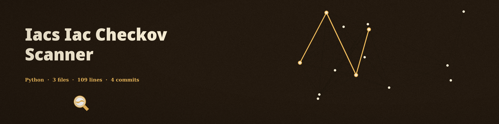

# iacs-iac-checkov-scanner
A wrapper around the checkov scanner: it builds a checkov command for a Terraform, CloudFormation, or Kubernetes path, runs it, prints checkov's output as the scan report in the format asked for, and exits with checkov's return code, so findings and scanner errors both gate a script or CI step. A missing checkov executable exits 1. It does no scanning of its own, and it does not analyze dependencies or check license compatibility; earlier text describing a dependency analyzer described a different tool and has been removed. Prerequisites: Python packages `click` and `checkov`, both listed in requirements.txt, and the `checkov` executable on your PATH.

## Install
`git clone https://github.com/ShadowStrikeHQ/iacs-iac-checkov-scanner`
Then install the prerequisites: `pip install -r requirements.txt`

## Usage
`python3 main.py -i path/to/iac -o json -s HIGH -f terraform`

## Parameters
- `-h`: Show help message and exit
- `-i, --iac-path`: Path to the IaC directory or file to scan
- `-o, --output-format`: Output format, json or text (default: text). In json mode, checkov's findings are parsed and printed as JSON on any checkov return code.
- `-s, --severity`: Minimum severity level to report: LOW, MEDIUM, HIGH, or CRITICAL (default: MEDIUM)
- `-f, --framework`: IaC framework to scan: terraform, cloudformation, or kubernetes (default: terraform)
- `-cf, --checkov-flags`: Additional flags to pass to checkov

## License
Copyright (c) ShadowStrikeHQ
